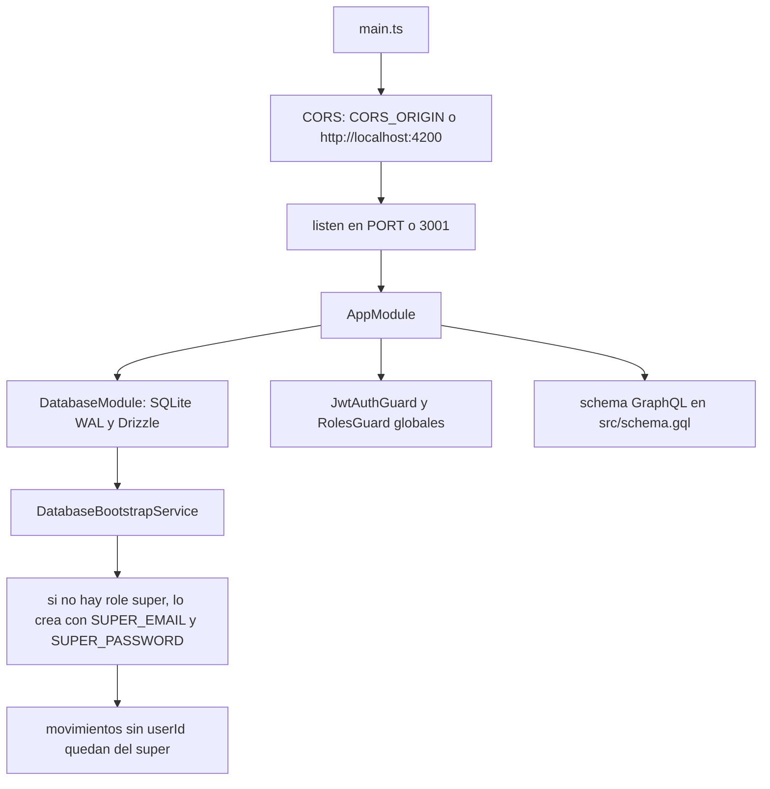
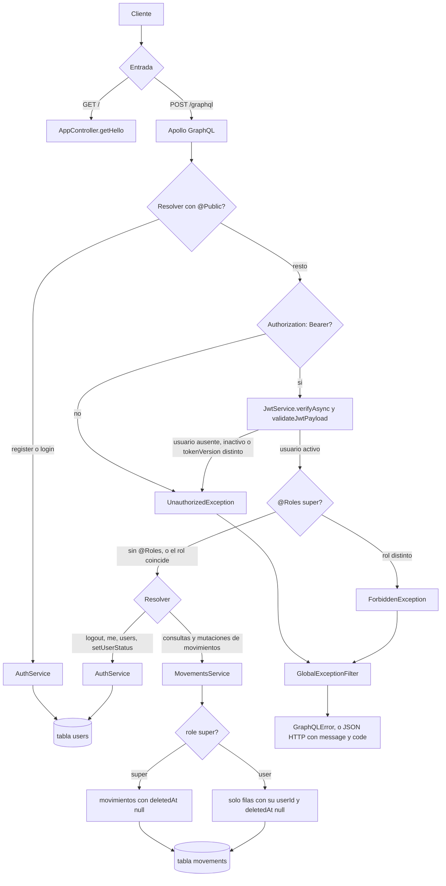
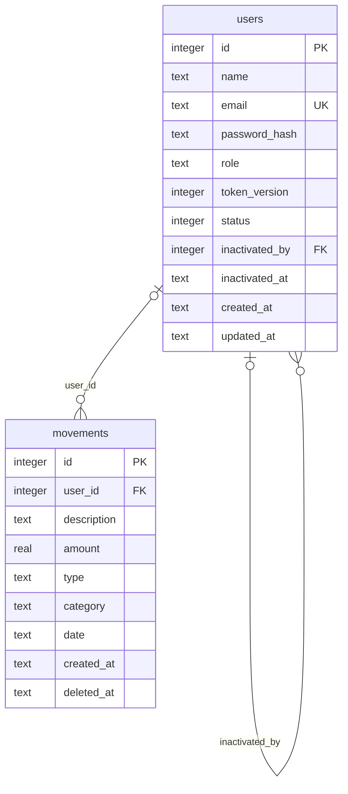

# Finanzas personales — backend

API GraphQL para registrar ingresos y gastos, consultar movimientos y obtener resúmenes por periodo, categoría y mes. Incluye autenticación JWT, registro de usuarios y roles (`user` / `super`).

Stack: **NestJS**, **Apollo GraphQL**, **Drizzle ORM**, **SQLite**, **JWT** y **bcrypt**.

## Requisitos

- Node.js 20 o superior
- npm

## Configuración

```bash
npm install
cp .env.example .env
# Edita .env: JWT_SECRET, SUPER_EMAIL y SUPER_PASSWORD son obligatorios
npm run db:migrate
```

Variables de entorno (ver `.env.example`):

| Variable | Default | Descripción |
| --- | --- | --- |
| `PORT` | `3001` | Puerto HTTP |
| `DATABASE_URL` | `file:./data/sqlite.db` | Ruta de SQLite |
| `CORS_ORIGIN` | `http://localhost:4200` | Origen permitido del front (Angular) |
| `JWT_SECRET` | — | Secreto para firmar tokens (obligatorio) |
| `JWT_EXPIRES_IN` | `7d` | Expiración del access token |
| `SUPER_EMAIL` | — | Email del usuario super (primer arranque) |
| `SUPER_PASSWORD` | — | Contraseña del super (primer arranque) |

En el primer arranque, si no existe un usuario con rol `super`, se crea uno con `SUPER_EMAIL` y `SUPER_PASSWORD`. Los movimientos existentes sin dueño se asignan a ese super.

## Ejecutar

```bash
# desarrollo con recarga
npm run start:dev

# producción
npm run build
npm run start:prod
```

El servidor queda en `http://localhost:3001`. El playground GraphQL está en `http://localhost:3001/graphql`.

CORS está habilitado para el origen configurado en `CORS_ORIGIN`, para que el front en `http://localhost:4200` pueda llamar a GraphQL.

## Flujo

### Arranque



`main.ts` crea la app Nest, habilita CORS y escucha en `PORT`. `DatabaseModule` abre SQLite en modo WAL y expone el cliente Drizzle. Al iniciar, `DatabaseBootstrapService` crea el usuario `super` si no existe y asigna a ese usuario los movimientos que no tienen `userId`. `AuthModule` registra `JwtAuthGuard` y `RolesGuard` como guards globales. El schema GraphQL se escribe en `src/schema.gql`. En tests (`VITEST`) se escribe en un archivo temporal.

### Petición



`GET /` no entra a GraphQL. `AppController` responde el saludo. Los guards lo dejan pasar porque el contexto no es GraphQL.

`POST /graphql` sigue este orden:

1. Si el resolver tiene `@Public()` (`register`, `login`), `JwtAuthGuard` no pide token.
2. En el resto exige `Authorization: Bearer`. Verifica la firma y llama a `validateJwtPayload`. El usuario tiene que existir, tener `status` activo y el `tokenVersion` del JWT tiene que coincidir con el de la fila. Si falla, responde `UnauthorizedException`.
3. Si el resolver tiene `@Roles(UserRole.super)` (`users`, `setUserStatus`), `RolesGuard` compara el rol. Si no coincide, responde `ForbiddenException`.
4. Auth delega en `AuthService` (tabla `users`). Movimientos delegan en `MovementsService`. Un `user` solo lee y cambia filas con su `userId`. Un `super` ve todas las que tienen `deletedAt` nulo. `deleteMovement` escribe `deletedAt`; no borra la fila.
5. `GlobalExceptionFilter` convierte la excepción. En GraphQL devuelve un `GraphQLError` con `extensions.code`. En HTTP devuelve JSON `{ message, code }`.

El JWT lleva `sub`, `role` y `tokenVersion`. `register` guarda la contraseña con bcrypt (coste 10) y rechaza un email ya registrado. `logout` e inactivar una cuenta incrementan `tokenVersion`, así el token anterior deja de pasar el guard. El usuario `super` no se puede inactivar.

## Modelo de datos

SQLite tiene dos tablas. El schema Drizzle está en `src/database/schema/`. Las columnas de abajo usan el nombre de la base.



`users` guarda la cuenta. `movements.user_id` apunta al dueño. `users.inactivated_by` apunta al usuario que inactivó esa cuenta. Las dos claves son opcionales: un movimiento puede nacer sin dueño y una cuenta activa no tiene quien la haya inactivado.

Reglas que el diagrama no muestra solas:

- `email` es único. El índice `users_single_super_idx` permite una sola fila con `role = 'super'`.
- `role` vale `user` o `super`. El default es `user`.
- `status` es un entero booleano. `1` es activo. El default es activo.
- `token_version` empieza en `0`. `logout` e inactivar la cuenta lo incrementan.
- `inactivated_at` guarda el momento de la inactivación. Con la cuenta activa, `inactivated_by` e `inactivated_at` quedan vacíos.
- `password_hash` es bcrypt. La API GraphQL no lo devuelve.
- `movements.type` vale `income` o `expense`. `amount` es `real`.
- `date`, `created_at`, `updated_at`, `inactivated_at` y `deleted_at` son texto ISO.
- `deleted_at` vacío significa movimiento vigente. `deleteMovement` escribe esa columna.
- En el primer arranque, los movimientos con `user_id` vacío pasan al usuario `super`.

## Autenticación

El front debe enviar el token en cada operación GraphQL protegida:

```http
Authorization: Bearer <accessToken>
```

- **Públicas:** `register`, `login`
- **Autenticadas:** resto de queries y mutations (incluye movimientos y `me`)
- **Solo super:** query `users`, mutation `setUserStatus`

Cada **usuario** expone `status` (activo/inactivo), `createdAt`, `updatedAt`, y si está inactivo opcionalmente `inactivatedAt` e `inactivatedBy` (id del super que lo inactivó). Un usuario inactivo no puede hacer `login` ni usar un JWT ya emitido.

### Mutations de auth

- `register(input)` — crea usuario con rol `user` y `status` activo; devuelve `{ accessToken, user }`
- `login(input)` — devuelve `{ accessToken, user }` (falla si la cuenta está inactiva)
- `logout` — invalida el token actual (incrementa `tokenVersion` en servidor)
- `setUserStatus(id, status)` — activa o inactiva un usuario (solo `super`). Al inactivar guarda quién y cuándo, y revoca sus sesiones.

### Queries de auth

- `me` — usuario del token
- `users` — listado de usuarios (solo `super`)

### Roles y movimientos

- **`user`:** solo ve y modifica sus propios movimientos.
- **`super`:** ve y administra todos los movimientos; al crear, el movimiento queda a su nombre.

## Scripts útiles

| Script | Uso |
| --- | --- |
| `npm run start:dev` | Arranque en watch |
| `npm run db:generate` | Generar migraciones Drizzle |
| `npm run db:migrate` | Aplicar migraciones |
| `npm run db:push` | Empujar el schema a SQLite (dev) |
| `npm run test` | Tests unitarios (Vitest) |
| `npm run test:e2e` | Tests e2e |
| `npm run lint` | Lint con oxlint |

## API GraphQL

Endpoint: `POST http://localhost:3001/graphql`

Un **movimiento** tiene `description`, `amount`, `type` (`income` o `expense`), `category`, `date` y `userId`.

### Queries

- `movements(filter)` — listado; filtro opcional por `category`, `type`, `fromDate`, `toDate`
- `movement(id)` — uno por id
- `movementSummary(fromDate, toDate)` — totales de ingreso, gasto y balance
- `movementsByCategory(fromDate, toDate)` — agregados por categoría
- `movementsByMonth(fromDate, toDate)` — agregados por mes
- `me` — perfil del usuario autenticado
- `users` — todos los usuarios (solo super)

### Mutations

- `createMovement(input)`
- `updateMovement(id, input)`
- `deleteMovement(id)`
- `register(input)`
- `login(input)`
- `logout`
- `setUserStatus(id, status)` (solo super)

Ejemplo (tras `login`):

```graphql
query {
  movements {
    id
    description
    amount
    type
    category
    date
    userId
  }
}
```

El schema generado está en `src/schema.gql`.

## Estructura

```
src/
  main.ts                 # bootstrap, CORS y puerto
  app.module.ts           # GraphQL + módulos
  auth/                   # JWT, registro, login, roles
  database/               # Drizzle + SQLite + bootstrap super
  movements/              # entidad, resolver y servicio
```
